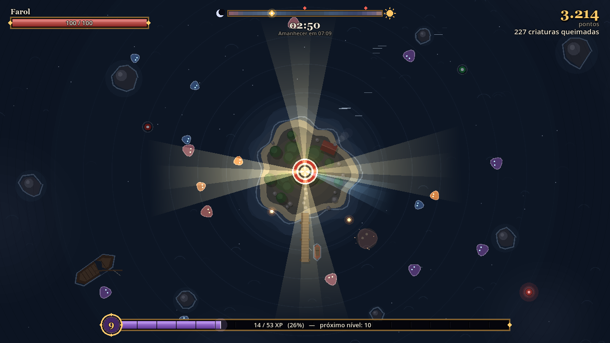

# Fogkeeper

Um farol fixo numa ilha cercada de névoa. Gire o feixe, queime as criaturas e resista do crepúsculo até o amanhecer.

Survivors-like feito em **Godot 4.4** (GDScript). Visual, interface e sons são todos gerados por código; ainda não há arquivos de arte ou áudio.



## Como rodar
1. Instale o [Godot 4.4](https://godotengine.org/download) (versão padrão, não a .NET).
2. Abra o Godot, clique em **Importar** e selecione o `project.godot` desta pasta.
3. Aperte **F5**.

## Controles
Teclas do teclado podem ser trocadas em **Configurações → Controles**.

| Ação | Teclado/mouse (padrão) | Controle |
|---|---|---|
| Girar o feixe | Mouse, A/D ou ←/→ | Analógico direito (mira) ou esquerdo (gira) |
| Clarão | Espaço ou Q | LB |
| Sobrecarga | Shift, E ou botão direito do mouse | RB |
| Sino da Névoa | R ou F | Y |
| Navegar nas cartas (mapa, farol, dificuldade, melhoria) | A/D, ←/→ ou mouse | D-pad |
| Escolher | Enter, Espaço, 1-5 ou clique | A |
| Trocar as cartas / banir uma (na escolha de melhoria) | T / B | X / Back |
| Pausar / voltar | Esc ou P | Start / B |

## O que tem no jogo
- Cinco mapas de cinco mitologias, com história contada antes da partida: **Baía da Névoa** (Leviatã e Kraken), **Fiorde Congelado** (Jötunn e Fenrir), **Rio Encantado**, do folclore brasileiro (Iara, Boitatá e Cuca), **Mar dos Yōkai** (Umibōzu e Kyūbi) e **Farol de Alexandria** (Esfinge e Apep), cada um com criaturas, clima e trilha diferentes.
- Criaturas especiais que mexem na mira: ladras de brasas, espelhos que refletem a luz, mariposas que crescem na luz e névoas que apagam as brasas.
- Evoluções de melhorias, troca e banimento de cartas.
- Oficina do faroleiro: óleo ganho em toda partida compra melhorias permanentes e libera mapas, faróis e cartas.
- Modo sem fim depois do amanhecer, 24 conquistas e um tutorial guiado.
- Nove idiomas: português, inglês, espanhol, francês, alemão, russo, chinês simplificado, japonês e coreano.
- Toque na tela: tocar nas habilidades e botão de pausa (base para a versão de celular).
- Quatro faróis para escolher (só aparência; três se liberam na oficina).
- Cinco dificuldades: Fácil, Normal, Médio, Difícil e Impossível, com regras próprias (elites, fúria dos chefes, chefe extra).
- Habilidades ativas com recarga, chefes com mecânicas e relíquias, música que muda antes e durante as lutas.
- Uma noite em 10 minutos, das 18:00 às 06:00, com tempestade ou nevasca no meio.
- Configurações de idioma, controles, gráficos e áudio (inclusive dispositivo de saída e sons individuais).
- Histórico de partidas e ranking local com posição ("1º lugar") e a regra de pontuação na tela.

Preferências, histórico e progresso (`progress.json`) ficam na pasta de dados do Godot (`%APPDATA%/Godot/app_userdata/Fogkeeper/` no Windows).

## Ferramentas
```bash
GODOT=/caminho/do/godot tools/check.sh        # carrega o projeto, acusa erros e textos sem tradução
GODOT=/caminho/do/godot tools/autoplay.sh 10 --difficulty=hard --map=fjord  # partidas com bot
GODOT=/caminho/do/godot tools/export.sh       # gera build/windows/Fogkeeper.exe (um arquivo só)
godot --path . --script tools/store_art.gd     # arte da loja da Steam em docs/store/
godot --path . --resolution 1920x1080 --fixed-fps 30 --write-movie build/trailer_en.avi -- --trailer=en  # trailer
godot --path . -- --ui=levelup --screenshot=3 # abre uma tela e salva user://screenshot.png
```
O bot mira no inimigo mais próximo e escolhe melhorias ao acaso; serve como termômetro de balanceamento. Outras opções de linha de comando estão no topo de `scripts/core/main.gd`.

## Documentação
- `docs/GAME_DESIGN.md`: pilares, estado atual, pontuação e próximos passos.
- `docs/STEAM.md`: roteiro de publicação.
- `.claude/skills/fogkeeper-dev/`: skill com as orientações do projeto para o Claude (Claude Code carrega automaticamente).

## Licença
Defina uma licença antes de tornar o repositório público. Para um jogo comercial, o mais comum é manter o código fechado ("todos os direitos reservados").
